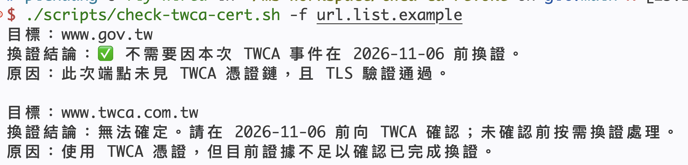

# TWCA 網站憑證換證檢查



檢查網站是否需要因 TWCA 2026 年事件，在 **2026-11-06 前更換憑證**。

這個工具只做檢查，**不會修改網站或自動更換憑證**。

## 1. 準備工具

需要 Bash 3.2 以上、OpenSSL 3 以上，以及網路連線。

**macOS**：先安裝 [Homebrew](https://brew.sh/)，再於終端機執行：

```bash
brew install openssl@3
export OPENSSL_BIN="$(brew --prefix openssl@3)/bin/openssl"
```

macOS 內建的 LibreSSL 無法使用。每次開啟新的終端機，都要重新執行上面的 `export`。

**Ubuntu／Debian**：使用提供 OpenSSL 3 以上的版本，執行：

```bash
sudo apt-get install openssl ca-certificates
```

## 2. 執行檢查

在終端機切換到這個專案資料夾，再執行以下指令。

**檢查一個網站**：把範例網址改成你要檢查的網站。

```bash
bash scripts/check-twca-cert.sh https://www.twca.com.tw/
```

也可以只填網域，例如 `www.twca.com.tw`。請勿使用 `http://` 或直接填 IP 位址。

**檢查多個網站**：在 [url.list](url.list) 中每行填一個網址或網域，也可參考 [url.list.example](url.list.example)。

```text
www.twca.com.tw
www.gov.tw
```

接著執行：

```bash
bash scripts/check-twca-cert.sh -f url.list
```

`-f` 與 `--file` 相同。空白行與 `#` 開頭的註解會略過；某個網站檢查失敗時，仍會繼續檢查其餘網站。

## 3. 看懂結果

| 結果 | 你需要做什麼 |
| --- | --- |
| ✅ 不需換證 | 此次檢查未發現本次 TWCA 事件的換證需求。 |
| ❌ 建議換證 | 請聯絡網站管理者或 TWCA，安排在期限前換證。 |
| 無法確定 | 請在期限前向 TWCA 確認；未確認前按需換證處理。 |
| 無法判定 | 檢查未完成或連線驗證失敗。請查看錯誤、重試，或交由網站管理者確認。 |

即使網站目前能正常開啟，也可能需要換證。**沒有看到 ❌，不一定代表不用換證**，也要留意「無法確定」與「無法判定」。

若你只是網站訪客，請將結果交給網站管理者；憑證更換需要由管理者處理。

## 需要更多資訊時

加上 `--verbose`，取得詳細結果供網站管理者查閱：

```bash
bash scripts/check-twca-cert.sh --verbose -f url.list
```

預設每個網站最多等待 15 秒；可用 `--timeout 30` 改為 30 秒。其他選項請查看：

```bash
bash scripts/check-twca-cert.sh --help
```

自動化使用時，退出碼 `0` 表示此次未發現換證需求且連線驗證通過，`1` 表示建議換證或需確認，`2` 表示有檢查錯誤或連線驗證失敗。`1` 不代表程式故障；批次檢查回傳所有結果中最高的退出碼。

## 注意事項與來源

- 這是根據公開候選清單提供的換證建議，不是官方撤銷狀態查詢；資料不會自動更新。
- 只檢查本次連線，不能保證網站的所有伺服器或所有瀏覽器結果相同。
- 期限採 **2026-11-06 00:00（+08:00）** 作為保守維運期限；官方公告未載時區，不代表已確認的撤銷時點。
- 管理者換證時需更新網站憑證及完整中繼鏈，再重新檢查並向 TWCA 核對，不能只補一張中繼憑證。
- 已在 macOS 搭配 OpenSSL 3 與 4 測試；Linux 尚未完成實測。

參考：[事件說明文章](https://sheng.page/posts/twca-intermediate-replacement-what-to-check/)、[TWCA 官方公告](https://ssl.twca.com.tw/news_detail/5f3395bf-bef6-4b40-b922-ceac4b06bf53)、[候選清單來源](https://bugzilla.mozilla.org/show_bug.cgi?id=2087236)。使用的比對資料見 [data/twca-intermediates.tsv](data/twca-intermediates.tsv)。

## 開發者測試

```bash
/bin/bash -n scripts/check-twca-cert.sh tests/test-check-twca-cert.sh
shellcheck --shell=bash scripts/check-twca-cert.sh tests/test-check-twca-cert.sh
/bin/bash tests/test-check-twca-cert.sh
```

一般使用者不需要安裝 ShellCheck；測試不需連線到公開網站。